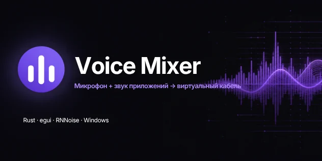
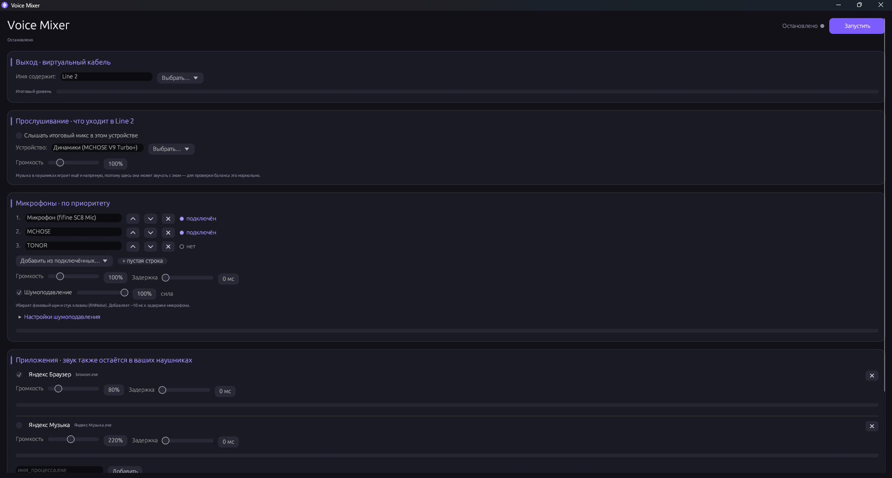
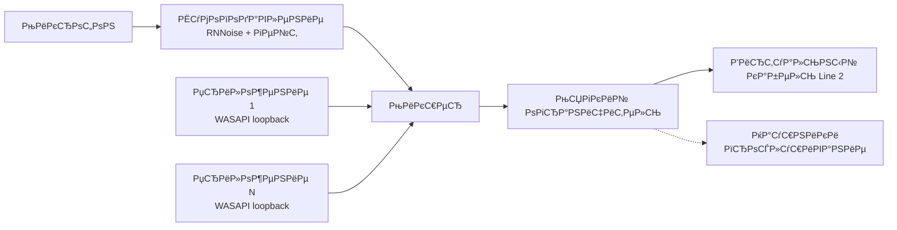

<p align="center"></p>

<h1 align="center">Voice Mixer</h1>

<p align="center"></p>

<!--  -->

[](https://www.rust-lang.org/)
[](https://www.microsoft.com/windows)
[](https://github.com/emilk/egui)
[](https://jmvalin.ca/demo/rnnoise/)

Лёгкий микшер для Windows. Берёт звук микрофона и звук отдельных приложений, смешивает и отправляет в виртуальный аудиокабель (по умолчанию **Line 2**). Дальше этот кабель выбирается микрофоном в Discord, OBS и подобных программах.

## Возможности

| Возможность | Описание |
|---|---|
| Микрофон + приложения | Микрофон и звук выбранных процессов (`browser.exe`, `Spotify.exe` и т. д.) смешиваются в один поток |
| Захват по процессу | Звук берётся только у нужного приложения (WASAPI process loopback), остальной системный звук в микс не попадает |
| Громкость и задержка | Для каждого источника своя громкость (0–500 %) и задержка (0–300 мс), чтобы синхронизировать голос и музыку |
| Шумоподавление | RNNoise с регулируемой степенью (0–100 %) |
| Гейт по голосу | Микрофон глушится, пока вы молчите. Срабатывает по вероятности голоса из RNNoise (VAD) |
| Приоритет микрофонов | Список микрофонов по порядку: используется первый найденный |
| Прослушивание | Итоговый микс можно слушать в наушниках |
| Мягкий ограничитель | При большом усилении пики сжимаются плавно, без жёсткого клиппинга |
| Трей и автозапуск | Закрытие в трей, запуск вместе с Windows (`--minimized`) |
| Автопереподключение | Устройства и процессы отслеживаются: приложение запустили позже, микрофон переподключили, и всё подхватывается само |

## Как это работает



## Требования

- Windows 10 (современные сборки) или Windows 11. Захват звука отдельного процесса работает не на всех старых версиях.
- Виртуальный аудиокабель, например [VB-CABLE](https://vb-audio.com/Cable/) или Virtual Audio Cable. По умолчанию программа ищет устройство вывода с «Line 2» в имени.
- [Rust](https://rustup.rs/) (stable) для сборки.

## РЎР±РѕСЂРєР°

```powershell
git clone https://github.com/Waywardfucker/voice_mixer.git
cd voice_mixer
cargo build --release
```

Готовый файл: `target\release\voice-mixer.exe`.

## Быстрая настройка

1. Установите виртуальный кабель и запустите `voice-mixer.exe`.
2. В блоке **Вывод** укажите часть имени кабеля (например, `Line 2` или `CABLE Input`). Подходящие устройства из списка можно выбрать кликом.
3. В блоке **Микрофон** впишите части названий ваших микрофонов по приоритету. Если оставить список пустым, будет использован микрофон Windows по умолчанию.
4. Добавьте приложения, звук которых нужен в миксе: введите имя процесса (`имя_процесса.exe`) или выберите из быстрых пресетов (Chrome, Edge, Firefox, Spotify и др.).
5. В Discord/OBS выберите в качестве микрофона тот же виртуальный кабель (его выход, например `Line 2` или `CABLE Output`).
6. Если хотите слышать итоговый микс сами, включите прослушивание и выберите наушники. Это должно быть другое устройство, не то же, что вывод.

Настройки сохраняются автоматически.

## Конфигурация

Файл: `%APPDATA%\VoiceMixer\config.toml`. Он создаётся при первом запуске, обычно редактировать его вручную не нужно.

| Параметр | По умолчанию | Описание |
|---|---|---|
| `output` | `"Line 2"` | Часть имени устройства вывода (виртуальный кабель) |
| `mics` | `[]` | Микрофоны по приоритету: части имён устройств. Если список пуст, используется микрофон Windows по умолчанию (устройство с кабелем вывода пропускается, чтобы звук не зациклился) |
| `mic_volume` | `1.0` | Громкость микрофона |
| `mic_delay_ms` | `0.0` | Задержка микрофона, мс |
| `running` | `true` | Микшер включён |
| `tray_on_close` | `true` | Закрытие окна сворачивает в трей |
| `monitor_on` | `false` | Прослушивание итогового микса |
| `monitor_device` | `""` | Часть имени устройства для прослушивания |
| `monitor_volume` | `0.7` | Громкость прослушивания |
| `denoise_on` | `false` | Шумоподавление RNNoise |
| `denoise_amount` | `1.0` | Степень подавления: 0 — без изменений, 1 — полностью обработанный сигнал |
| `gate_on` | `false` | Гейт по голосу (работает вместе с шумоподавлением) |
| `gate_threshold` | `0.5` | Порог вероятности голоса (0.05–0.95) |
| `gate_hold_ms` | `200.0` | Удержание гейта открытым после речи, мс (0–600) |
| `gate_depth_db` | `40.0` | Насколько гейт приглушает микрофон в тишине, дБ (6–80) |

Пример:

```toml
output = "Line 2"
mics = ["Моя гарнитура", "USB Microphone"]
mic_volume = 1.0
mic_delay_ms = 0.0
running = true
tray_on_close = true
monitor_on = true
monitor_device = "Headphones"
monitor_volume = 0.7
denoise_on = true
denoise_amount = 1.0
gate_on = true
gate_threshold = 0.5
gate_hold_ms = 200.0
gate_depth_db = 40.0

[[apps]]
label = "Spotify"
exe = "Spotify.exe"
enabled = true
volume = 0.6
delay_ms = 0.0
```

## Стек

- [Rust](https://www.rust-lang.org/), GUI: [eframe / egui](https://github.com/emilk/egui)
- Аудио: [cpal](https://github.com/RustAudio/cpal) (микрофон и вывод), [wasapi](https://crates.io/crates/wasapi) (захват звука процесса)
- Шумоподавление: [nnnoiseless](https://crates.io/crates/nnnoiseless) (порт RNNoise на Rust)
- Остальное: `sysinfo` (поиск процессов), `tray-icon`, `winreg` (автозапуск), `serde` + `toml` (конфиг)

## Известные ограничения

- Только Windows: используются WASAPI и реестр.
- Звук приложения захватывается вместе с его дочерними процессами. Если приложение ничего не играет, источник просто молчит.
- Приложение ищется по имени процесса. Если запущено несколько копий, выбирается самый ранний корневой процесс.
- При включённом шумоподавлении микрофон обрабатывается как моно на частоте 48 кГц.
- Ресемплинг линейный: для голоса достаточно, но это не студийное качество.
- Задержка меняется не мгновенно: после изменения буфер источника заполняется заново.

## Лицензия

MIT, см. файл [LICENSE](LICENSE).


