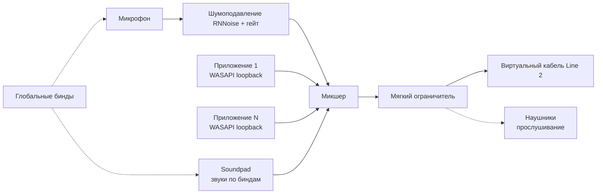

<p align="center"></p>

<h1 align="center">Voice Mixer</h1>

<p align="center"></p>

<p align="center">
<b>Микшер + Soundpad + шумоподавление в одном лёгком приложении для Windows.</b><br>
Микрофон, звук отдельных приложений и звуки по горячим клавишам, всё в виртуальный кабель для Discord, OBS и игр.
</p>

<p align="center">
<a href="https://www.rust-lang.org/"></a>
<a href="https://www.microsoft.com/windows"></a>
<a href="https://github.com/emilk/egui"></a>
<a href="https://jmvalin.ca/demo/rnnoise/"></a>
<a href="LICENSE"></a>
</p>

<!--  -->
<!--  -->

## Зачем это нужно

Обычно для голосового чата и стримов собирают несколько программ: одну для звуков по кнопкам, другую для микширования, третью для шумоподавления. Voice Mixer делает всё это в одном маленьком приложении без установщика и без подписок.

| Задача | Чем обычно закрывают | В Voice Mixer |
|---|---|---|
| Включать звуки и мемы в микрофон по горячим клавишам | Soundpad и подобные | вкладка **Soundpad**: перетащили файл, назначили бинд |
| Смешать микрофон и звук отдельных программ в один вывод | Voicemeeter и подобные | вкладка **Микшер**: громкость и задержка на каждый источник |
| Убрать шум и стук клавиш | отдельные шумодавы | **RNNoise** и гейт по голосу |
| Быстро выключить микрофон, переключить настройки | горячие клавиши в разных программах | вкладка **Бинды**: глобальные сочетания на любое действие |

Все названия принадлежат их владельцам, Voice Mixer с ними не связан. Таблица показывает задачи, а не заявляет полную замену каждого продукта по всем функциям.

**Чего пока нет** (смотрите [планы](#планы)): оверлея поверх игр, редактора звуков, цепочек биндов.

## Возможности

| Возможность | Описание |
|---|---|
| Soundpad | Звуки (mp3, wav, ogg, flac, m4a) уходят прямо в микс. Громкость каждого звука, зацикливание, общая громкость, кнопка «Стоп всё» |
| Глобальные бинды | Сочетания вроде `Ctrl+Alt+1` работают в играх и когда программа свёрнута в трей. Любое сочетание клавиш с Ctrl, Alt и Shift |
| Бинды на действия | Микрофон вкл/выкл, шумоподавление, гейт, прослушивание, запуск и остановка микшера, звук конкретного приложения, «стоп всем звукам», показать окно |
| Микрофон + приложения | Микрофон и звук выбранных процессов (`browser.exe`, `Spotify.exe` и т. д.) смешиваются в один поток |
| Захват по процессу | Звук берётся только у нужного приложения (WASAPI process loopback), остальной системный звук в микс не попадает |
| Громкость и задержка | Для каждого источника своя громкость (0–500 %) и задержка (0–300 мс) |
| Шумоподавление | RNNoise с регулируемой степенью (0–100 %) |
| Гейт по голосу | Микрофон глушится, пока вы молчите. Срабатывает по вероятности голоса из RNNoise (VAD) |
| Темы | 6 тем оформления: Фиолет, Океан, Лес, Закат, Неон, Графит |
| Профили и конфиги | Сохранённые наборы настроек, экспорт и импорт в файл |
| Приоритет микрофонов | Список микрофонов по порядку. Если список пуст, берётся микрофон Windows по умолчанию |
| Прослушивание | Итоговый микс (вместе со звуками Soundpad) можно слушать в наушниках |
| Мягкий ограничитель | При большом усилении пики сжимаются плавно, без жёсткого клиппинга |
| Трей и автозапуск | Закрытие в трей, запуск вместе с Windows (`--minimized`) |
| Автопереподключение | Устройства и процессы отслеживаются: приложение запустили позже, микрофон переподключили, и всё подхватывается само |

## Как это работает



## Soundpad и бинды

1. Откройте вкладку **Soundpad** и нажмите «Добавить звуки…» или перетащите файлы в окно.
2. Нажмите «бинд: не задан» у нужного звука и нажмите сочетание клавиш, например `Ctrl+Alt+1`. Esc отменяет назначение.
3. Нажимайте сочетание где угодно: звук сыграет в микрофон и (если включено прослушивание) в ваши наушники.
4. У звука можно включить «зациклить»: повторное нажатие бинда остановит его.

Вкладка **Бинды** задаёт сочетания на действия: выключить микрофон, переключить шумоподавление, остановить все звуки и другие. Без Ctrl, Alt или Shift можно использовать только клавиши F1–F24, чтобы не перехватывать обычный ввод.

## Требования

- Windows 10 (современные сборки) или Windows 11. Захват звука отдельного процесса работает не на всех старых версиях.
- Виртуальный аудиокабель, например [VB-CABLE](https://vb-audio.com/Cable/) или Virtual Audio Cable. По умолчанию программа ищет устройство вывода с «Line 2» в имени.
- [Rust](https://rustup.rs/) (stable) для сборки.

## Сборка

```powershell
git clone https://github.com/Waywardfucker/voice_mixer.git
cd voice_mixer
cargo build --release
```

Готовый файл: `target\release\voice-mixer.exe`. Готовые сборки лежат в разделе [Releases](https://github.com/Waywardfucker/voice_mixer/releases).

## Быстрая настройка

1. Установите виртуальный кабель и запустите `voice-mixer.exe`.
2. В блоке **Выход** укажите часть имени кабеля (например, `Line 2` или `CABLE Input`). Подходящие устройства из списка можно выбрать кликом.
3. В блоке **Микрофон** впишите части названий ваших микрофонов по приоритету. Если оставить список пустым, будет использован микрофон Windows по умолчанию.
4. Добавьте приложения, звук которых нужен в миксе: введите имя процесса (`имя_процесса.exe`) или выберите из быстрых пресетов (Chrome, Edge, Firefox, Spotify и др.).
5. В Discord/OBS выберите в качестве микрофона тот же виртуальный кабель (его выход, например `Line 2` или `CABLE Output`).
6. Если хотите слышать итоговый микс сами, включите прослушивание и выберите наушники. Это должно быть другое устройство, не то же, что вывод.
7. Добавьте звуки на вкладке Soundpad и назначьте им бинды.

Настройки сохраняются автоматически.

## Конфигурация

Файл: `%APPDATA%\VoiceMixer\config.toml`. Он создаётся при первом запуске. Профили лежат в `%APPDATA%\VoiceMixer\profiles\`. Обычно править файл вручную не нужно: всё настраивается в окне, а на вкладке «Настройки» есть экспорт и импорт.

| Параметр | По умолчанию | Описание |
|---|---|---|
| `output` | `"Line 2"` | Часть имени устройства вывода (виртуальный кабель) |
| `mics` | `[]` | Микрофоны по приоритету: части имён устройств. Если список пуст, используется микрофон Windows по умолчанию (устройство с кабелем вывода пропускается, чтобы звук не зациклился) |
| `mic_volume` | `1.0` | Громкость микрофона |
| `mic_delay_ms` | `0.0` | Задержка микрофона, мс |
| `mic_muted` | `false` | Микрофон выключен |
| `running` | `true` | Микшер включён |
| `tray_on_close` | `true` | Закрытие окна сворачивает в трей |
| `monitor_on` | `false` | Прослушивание итогового микса |
| `monitor_device` | `""` | Часть имени устройства для прослушивания |
| `monitor_volume` | `0.7` | Громкость прослушивания |
| `denoise_on` | `false` | Шумоподавление RNNoise |
| `denoise_amount` | `1.0` | Степень подавления: 0 — без изменений, 1 — полностью обработанный сигнал |
| `gate_on` | `false` | Гейт по голосу (работает вместе с шумоподавлением) |
| `gate_threshold` | `0.5` | Порог вероятности голоса (0.05–0.95) |
| `gate_hold_ms` | `200.0` | Удержание гейта открытым после речи, мс (0–600) |
| `gate_depth_db` | `40.0` | Насколько гейт приглушает микрофон в тишине, дБ (6–80) |
| `theme` | `"Фиолет"` | Тема оформления |
| `pad_volume` | `1.0` | Общая громкость Soundpad |

Пример:

```toml
output = "Line 2"
mics = ["Моя гарнитура", "USB Microphone"]
theme = "Океан"
pad_volume = 1.0
denoise_on = true
gate_on = true

[[apps]]
label = "Spotify"
exe = "Spotify.exe"
enabled = true
volume = 0.6
delay_ms = 0.0

[[sounds]]
name = "Аплодисменты"
path = "C:\\Sounds\\applause.mp3"
volume = 0.8
looped = false
key = "Ctrl+Alt+1"

[[binds]]
action = "toggle_mic_mute"
key = "Ctrl+Alt+M"
```

Действия для `binds`: `toggle_mic_mute`, `toggle_denoise`, `toggle_gate`, `toggle_monitor`, `toggle_running`, `stop_sounds`, `show_window`, `app:имя.exe`.

## Планы

Это планы, а не обещания. Что-то может поменяться.

- [ ] **Оверлей** поверх игр: прозрачное окно без рамки, всегда сверху и «прозрачное для мыши» (статус микрофона, уровни, подсказки биндов). Планируется на втором окне egui
- [ ] Редактор звуков: обрезка, нормализация, громкость по умолчанию
- [ ] Цепочки биндов (двухшаговые сочетания) и бинды с клавишей Win
- [ ] Группы и папки звуков, поиск по списку
- [ ] Эквалайзер и компрессор для микрофона
- [ ] Английский интерфейс
- [ ] Иконка у `voice-mixer.exe` и установщик

Идеи и пожелания можно оставить в [Issues](https://github.com/Waywardfucker/voice_mixer/issues).

## Стек

- [Rust](https://www.rust-lang.org/), GUI: [eframe / egui](https://github.com/emilk/egui)
- Аудио: [cpal](https://github.com/RustAudio/cpal) (микрофон и вывод), [wasapi](https://crates.io/crates/wasapi) (захват звука процесса), [symphonia](https://github.com/pdeljanov/Symphonia) (декодирование звуков)
- Шумоподавление: [nnnoiseless](https://crates.io/crates/nnnoiseless) (порт RNNoise на Rust)
- Горячие клавиши и диалоги: [global-hotkey](https://crates.io/crates/global-hotkey), [rfd](https://crates.io/crates/rfd)
- Остальное: `sysinfo` (поиск процессов), `tray-icon`, `winreg` (автозапуск), `serde` + `toml` (конфиг)

## Известные ограничения

- Только Windows: используются WASAPI и реестр.
- Звуки Soundpad играют, только пока микшер запущен. Одиночный звук ограничен 3 минутами, одновременно играет до 16 звуков.
- Поддерживаются mp3, wav, ogg, flac, m4a/aac. Формат opus не поддерживается.
- Бинды: сочетания клавиш с Ctrl, Alt и Shift. Если сочетание уже занято другой программой, на вкладке появится сообщение об ошибке.
- Звук приложения захватывается вместе с его дочерними процессами. Если приложение ничего не играет, источник просто молчит.
- Приложение ищется по имени процесса. Если запущено несколько копий, выбирается самый ранний корневой процесс.
- При включённом шумоподавлении микрофон обрабатывается как моно на частоте 48 кГц.
- Ресемплинг линейный: для голоса и коротких звуков достаточно, но это не студийное качество.
- Задержка меняется не мгновенно: после изменения буфер источника заполняется заново.

## Лицензия

MIT, см. файл [LICENSE](LICENSE).
